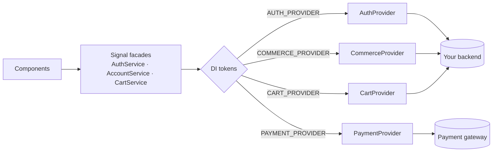

# Nova — Customization Guide

Everything you need to make Nova yours in minutes. This template is built with
**Angular 21** (zoneless, standalone, signals), **TailwindCSS v4**, Spartan-style
`helm` UI directives, and `@ng-icons/lucide`. State is powered by the **Signal API**;
the data layer (`EcommerceDataSource`) exposes **RxJS Observables**, while the auth and
account stores use **Promises**.

> TL;DR — Change your **brand colors** in `src/styles.css`, your **logo/name** in
> the header & footer, and point the app at your **API** in `src/app/app.config.ts`.
> That's 90% of a rebrand.

> ✨ **New: Theme Studio.** In dev mode (`ng serve`) a floating **paintbrush
> button** appears on the right edge. Click it to visually edit colors, radius,
> font, brand and menu — live, with zero code. See section 0 below.

## Table of contents

- [0. Theme Studio — the visual customizer](#0-theme-studio--the-visual-customizer-dev-only)
- [1. Rebrand the colors](#1-rebrand-the-colors-2-minutes)
- [1b. Store settings — currency, tax & shipping](#1b-store-settings--currency-tax--shipping)
- [2. Rebrand the logo & name](#2-rebrand-the-logo--name-1-minute)
- [3. Connect your backend](#3-connect-your-backend-5-minutes)
- [4. Light / dark / system theme](#4-light--dark--system-theme)
- [5. Animations](#5-animations)
- [6. Routes & pages](#6-routes--pages)
- [7. Authentication](#7-authentication)
- [8. Orders, cart & payments](#8-orders-cart--payments)
- [9. Icons](#9-icons)
- [10. Run, build, deploy](#10-run-build-deploy)
- [11. Testing](#11-testing)
- [12. Troubleshooting and FAQ](#12-troubleshooting-and-faq)
- [Customization cheat-sheet](#customization-cheat-sheet)

---

## 0. Theme Studio — the visual customizer (dev only)


> The image above is a placeholder — replace `docs/screenshots/theme-studio.svg`
> with a real capture (see `docs/screenshots/README.md`).

When you run the app locally with `npm start` / `ng serve`, a floating
paintbrush **FAB** appears on the right side of the screen. Click it to open the
**Theme Studio** panel:

- **Style tab** — pick from 8 ready-made palettes (Nova Orange, Ocean, Violet,
  Emerald, Rose, Cyan, Amber, Slate), fine-tune individual color tokens with a
  color picker, and set the **corner radius**, **font** and **base text size**.
  Edits apply live and are theme-aware — toggle light/dark inside the panel and
  edit each mode independently.
- **Brand tab** — change the site **name**, the **logo letter**, or paste a
  **logo image URL**. The header and footer update instantly.
- **Menu tab** — add, rename, reorder or delete the header navigation items.
- **Store tab** — change the **currency** (symbol, code, position, decimals,
  locale), **tax** (rate + label) and **shipping** (methods, free-shipping
  threshold, flat rate). Prices, the cart and checkout update live.
- **Code tab** — copy the generated CSS and config, or (recommended) use
  **Save to project** to write everything back to source automatically.

**One-click Save (no copy/paste).** In Chromium-based browsers (Chrome/Edge),
the panel footer shows a **Save to project** button. Click it, pick your project
root folder once (the one containing `angular.json` — the grant is remembered),
and the studio writes your changes directly into source:

- color tokens, corner radius, base size and font → `src/styles.css`
- brand, menu, radius, base size and font defaults → `src/app/core/customizer.service.ts`
- currency, tax and shipping defaults → `src/app/core/store-config.service.ts`
- an **uploaded logo image** → `public/nova-logo.<ext>` (referenced automatically)

The dev server hot-reloads and your edits become the compiled default — no
copy/paste. In other browsers the button falls back to the **Code** tab for
manual copy. (The File System Access API only runs on `localhost` in dev.)

**Logos:** in the **Brand** tab you can either **upload an image** (PNG/SVG/JPG)
or paste a URL. Uploaded images preview instantly and are written into `public/`
on Save.

Your tweaks are saved to `localStorage`, so they survive reloads while you
experiment. Use **Reset** in the panel footer to return to defaults.

**It never ships to production.** The customizer is gated behind Angular's
`isDevMode()` and lazy-loaded via `@defer (when devMode)`. In a production
build (`ng build`) the condition is always false, so the customizer chunk is
never fetched and no FAB is rendered. To make changes permanent, just hit
**Save to project** (Chromium) — or use the **Code** tab to export manually.

To add your own palettes, fonts or editable tokens, edit
`src/app/core/customizer-data.ts`.

---

## 1. Rebrand the colors (2 minutes)

All theming lives in **`src/styles.css`** as [OKLCH](https://oklch.com) design tokens.
Edit the values under `:root` (light) and `.dark` (dark) — every component reads
from these, so one change cascades everywhere.

```css
:root {
  --accent: oklch(0.7 0.14 48);      /* ← your brand color (orange by default) */
  --primary: oklch(0.21 0.02 275);   /* buttons, logo chip */
  --background: oklch(0.99 0 0);
  --foreground: oklch(0.16 0.01 275);
  --radius: 0.75rem;                  /* corner roundness, app-wide */
}
```

| Token | Used for |
|-------|----------|
| `--accent` | Primary calls-to-action, links, highlights, active states |
| `--primary` | Logo chip, dark buttons, headings emphasis |
| `--secondary` / `--muted` | Subtle backgrounds, chips, skeletons |
| `--card` / `--popover` | Surfaces, dropdowns, modals |
| `--border` / `--input` / `--ring` | Outlines and focus rings |
| `--destructive` / `--success` | Errors and confirmations |
| `--chart-1..5` | Data-viz accents & multi-color gradients |

**Tips**
- Keep the same **L** (lightness) between light/dark for consistent contrast.
- Only need one brand hue? Change `--accent` (and its `.dark` twin) and you're done.
- Pick colors visually at [oklch.com](https://oklch.com) and paste the value.

### Radius, fonts & text size
- **Corner radius:** change `--radius` once — all cards, inputs, and buttons follow.
- **Font:** set the `--font-sans` family (add a `@theme { --font-sans: '...' }` block
  in `styles.css`) and load the web font in `src/index.html`.
- **Base text size:** the `--font-size-base` token on `:root` sets the root `rem`,
  scaling typography and spacing across the whole storefront. Edit it in `styles.css`
  or use the Theme Studio › Style › **Base text size** slider.

---

## 1b. Store settings — currency, tax & shipping

Everything money-related is centralised in `src/app/core/store-config.service.ts` and
is **always active** (dev *and* production). Pricing (`PricePipe`), cart math
(`CartService`) and checkout all read from it, so one change flows everywhere.

Edit the compiled defaults, or use the Theme Studio › **Store** tab (dev only) to
change them live and hit **Save to project** to write new defaults back:

- **Currency:** `DEFAULT_CURRENCY` — `symbol` (`$`, `€`, `₹`…), `code`, `position`
  (`before`/`after`), `decimals`, and `locale` (digit grouping).
- **Tax:** `DEFAULT_TAX` — `rate` (a percent, e.g. `8` = 8%) and `label`
  (`Tax` / `VAT` / `GST`).
- **Shipping:** `DEFAULT_SHIPPING` — the `methods` list (checkout options),
  `freeThreshold` (free-shipping cutoff) and `flatRate` (cart estimate).

Wiring it to a backend: replace the seed defaults, or push API values into the
signals on app init — every consumer reacts automatically.

---

## 2. Rebrand the logo & name (1 minute)

The logo is a simple lettermark — no image assets required. Search the project for
`>N<` and `Nova` and replace:

- **Header:** `src/app/layout/header.html` (logo chip + wordmark)
- **Footer:** `src/app/layout/footer.html` (logo + tagline + newsletter)
- **Page titles / brand suffix:** `src/app/app.routes.ts` (each route's `title`)
- **Auth screens:** `src/app/features/auth/auth-shell.ts`

Swap the `N` chip for an `` if you have a mark, and update the
tagline text in the footer.

---

## 3. Connect your backend (5 minutes)

Nothing in the UI imports a concrete data source. Every screen depends on **one
contract**: `EcommerceDataSource` (`src/app/shared/data/data-source.ts`). Swap the
implementation in **one place** and the whole app follows.

### Option A — You control the API shape
Implement the interface directly (REST/GraphQL/tRPC) and provide it:

```ts
// src/app/app.config.ts
import { DATA_SOURCE } from './shared/data/data-source';
import { HttpDataSource } from './shared/data/http-data-source';

providers: [
  { provide: DATA_SOURCE, useClass: HttpDataSource },
]
```

### Option B — Map ANY existing API (recommended)
Real APIs never match your UI models. Instead of rewriting screens, **describe where
each field lives** in `src/app/shared/data/schema-mapping.ts`. Nova normalizes
arbitrary JSON into its `Product` / `Category` models.

A field can be described three ways:
```ts
const mapping: ProductSchemaMapping = {
  id: 'id',                          // dot/bracket path
  title: ['title', 'name'],          // fallback list (first match wins)
  price: (raw) => raw.pricing.amount, // custom function
  thumbnail: 'images[0].src',
  categoryId: 'category',
  ratingAverage: 'rating.average',
  ratingCount: 'rating.count',
  stock: 'inventory.count',
};
```

Point `http-data-source.ts` at your base URL and pass your mapping — done. See the
worked **DummyJSON** example at the top of `schema-mapping.ts`.

### The contract
```ts
getProducts(query): Observable<PagedResult<Product>>
getProductById(id): Observable<Product | undefined>
getProductBySlug(slug): Observable<Product | undefined>
getFeaturedProducts(limit?): Observable<Product[]>
getRelatedProducts(productId, limit?): Observable<Product[]>
getCategories(): Observable<Category[]>
getFacets(query): Observable<CatalogFacets>   // powers the sidebar filters
getReviews(productId): Observable<Review[]>
```
Keep the mock (`MockDataSource`) for local development and Storybook-style demos.

### The write path — auth, orders, cart & payments

The catalogue above is the **read** side. Everything that *writes* (sign-in,
placing orders, the cart, payments) follows the **exact same recipe**: one
interface + one DI token per concern, each with a bundled mock default. Swap a
single provider line in `src/app/app.config.ts` to point that concern at a real
backend — the UI, guards and screens never change.



| Concern | Interface | Token | Default | Lives in |
|---------|-----------|-------|---------|----------|
| Catalogue (read) | `EcommerceDataSource` | `DATA_SOURCE` | `DummyJsonDataSource` | `shared/data/` |
| Auth | `AuthProvider` | `AUTH_PROVIDER` | `MockAuthProvider` | `core/providers/` |
| Orders | `CommerceProvider` | `COMMERCE_PROVIDER` | `MockCommerceProvider` | `core/providers/` |
| Cart | `CartProvider` | `CART_PROVIDER` | `LocalCartProvider` | `core/providers/` |
| Payments | `PaymentProvider` | `PAYMENT_PROVIDER` | `MockPaymentProvider` | `core/providers/` |

All the write interfaces, their tokens and mock defaults live under
`src/app/core/providers/` (re-exported from `core/providers/index.ts`).
Normalized write models (`AuthUser`, `Order`, `Address`, `PaymentMethod`,
`DraftOrder`, `PaymentResult`) live in `core/providers/models.ts` — the write-side
mirror of `shared/data/models.ts`. Every provider throws a `ProviderError`
(`{ code, message }`) on failure, so components handle errors uniformly; wrap
unknown errors with `toProviderError(err)`.

### One config, not scattered constants

Base URLs, API keys and mock latency live in a single place — the environment
files — so every adapter reads from one source:

```ts
// src/environments/environment.ts  (dev)  •  environment.prod.ts (prod build)
import type { AppConfig } from '../app/core/providers/app-config';

export const environment: AppConfig = {
  apiBaseUrl: 'https://api.example.com', // shared by HTTP data sources + providers
  apiKey: '',                            // forwarded as a header when set
  mockLatencyMs: 600,                    // simulated latency for the bundled mocks
};
```

The `APP_CONFIG` token is sourced from `environment` automatically, and the
production build swaps `environment.ts` → `environment.prod.ts` via
`fileReplacements` in `angular.json`. Adapters just `inject(APP_CONFIG)`:

```ts
private readonly base = inject(APP_CONFIG).apiBaseUrl;
```

Need to supply config another way (tests, SSR)? Override the token in
`src/app/app.config.ts`: `{ provide: APP_CONFIG, useValue: { ... } }`.

See **§7** (auth) and **§8** (orders, cart, payments) for full, copy-paste adapters.

---

## 4. Light / dark / system theme

Theming is fully wired via `ThemeService` (`src/app/core/theme.service.ts`):
- The header button cycles **light → dark → system**.
- The **Account → Settings** page has an explicit 3-way picker.
- Preference persists to `localStorage` and respects the OS setting in `system` mode.
- The `.dark` class is toggled on `<html>`; every token has a dark twin.

No setup required — it just works. To default everyone to dark, change the fallback
in `ThemeService.read()`.

---

## 5. Animations

A full motion system lives at the bottom of `src/styles.css`, exposed as Tailwind
utilities. Drop these classes on any element:

| Class | Effect |
|-------|--------|
| `animate-fade-up` / `animate-fade-down` | Enter with a soft slide |
| `animate-zoom-in` / `animate-scale-in` | Pop in |
| `animate-blob` | Organic morphing background orbs |
| `animate-pulse-glow` | Breathing glow |
| `animate-gradient-text` + `text-gradient` | Animated gradient headings |
| `animate-aurora` | Flowing aurora backdrops (used on auth) |
| `delay-100 … delay-700` | Stagger sequential reveals |

Utilities like `.glass`, `.glass-strong`, `.bg-grid`, `.bg-dots`, and `.gradient-ring`
provide instant premium surfaces. Prefer subtle, staggered reveals over constant motion.

---

## 6. Routes & pages

Routes are declared in **`src/app/app.routes.ts`** (all lazy-loaded).

| Area | Path |
|------|------|
| Storefront | `/`, `/catalog`, `/category/:id`, `/product/:slug` |
| Commerce | `/cart`, `/checkout`, `/order-confirmation`, `/wishlist` |
| Curated | `/new-arrivals`, `/best-sellers`, `/deals` (redirect to catalog with pre-applied sort/filter) |
| Account (auth-guarded) | `/account`, `/account/orders`, `/account/addresses`, `/account/payments`, `/account/settings` |
| Auth | `/login`, `/signup` |
| Utility | `/track-order`, `/gift-cards` |
| Info & legal | `/about`, `/careers`, `/press`, `/sustainability`, `/help`, `/shipping`, `/returns`, `/privacy`, `/terms`, `/cookies` |

### Add or edit an info page (no new component needed)
Info & legal pages are **data-driven**. Edit `src/app/features/info/info-content.ts`
and add an entry to `INFO_PAGES`, then register a route pointing at `InfoPage` with
`data: { page: 'your-key' }`. Each page supports a hero, stats, sections (prose or
bullets), an FAQ accordion, and a CTA.

### Curated catalogue links
`/new-arrivals`, `/best-sellers`, and `/deals` are guard redirects
(`catalog-redirect.guard.ts`) that forward to `/catalog` with query params
(`sort`, `onSale`). The catalog reads these on load — add your own shortcuts the same way.

---

## 7. Authentication

`AuthService` (`src/app/core/auth.service.ts`) is the signal-based, UI-facing store
(`user`, `isAuthenticated`, `loading`, `initials`, `token()`). It holds **no**
backend logic — it delegates every call to the injected **`AuthProvider`**
(`AUTH_PROVIDER`). The default `MockAuthProvider` validates locally and persists to
`localStorage`. The `authGuard` (`src/app/core/auth.guard.ts`) and every screen stay
identical no matter which provider you use — protect a route with
`canActivate: [authGuard]`.

**The contract** (`core/providers/auth.provider.ts`):
```ts
export interface AuthProvider {
  currentUser(): AuthUser | null;                  // restored on app start
  token(): string | null;                          // for HTTP interceptors
  login(credentials: Credentials): Promise<AuthUser>;
  signup(payload: SignupPayload): Promise<AuthUser>;
  loginWithProvider(provider: OAuthProvider): Promise<AuthUser>;
  logout(): Promise<void>;
  updateProfile(patch: Partial<Pick<AuthUser, 'name' | 'email' | 'avatarUrl'>>): Promise<AuthUser>;
  changePassword(current: string, next: string): Promise<void>;
}
```

**Real example — Platzi Fake Store API** (keyless; demo user `john@mail.com` /
`changeme`). Create `src/app/core/providers/platzi-auth.provider.ts`:
```ts
import { HttpClient } from '@angular/common/http';
import { Injectable, inject } from '@angular/core';
import { firstValueFrom } from 'rxjs';
import { AuthProvider } from './auth.provider';
import { AuthUser, Credentials, OAuthProvider, SignupPayload } from './models';
import { APP_CONFIG } from './app-config';
import { ProviderError } from './provider-error';

@Injectable({ providedIn: 'root' })
export class PlatziAuthProvider implements AuthProvider {
  private readonly http = inject(HttpClient);
  private readonly base = inject(APP_CONFIG).apiBaseUrl; // https://api.escuelajs.co/api/v1
  private accessToken: string | null = localStorage.getItem('token');
  private user: AuthUser | null = JSON.parse(localStorage.getItem('user') ?? 'null');

  currentUser() { return this.user; }
  token() { return this.accessToken; }

  async login({ email, password }: Credentials): Promise<AuthUser> {
    try {
      const { access_token } = await firstValueFrom(
        this.http.post<{ access_token: string }>(`${this.base}/auth/login`, { email, password }),
      );
      const p = await firstValueFrom(
        this.http.get<{ id: number; name: string; email: string; avatar: string }>(
          `${this.base}/auth/profile`,
          { headers: { Authorization: `Bearer ${access_token}` } },
        ),
      );
      this.accessToken = access_token;
      this.user = { id: String(p.id), name: p.name, email: p.email, avatarUrl: p.avatar };
      localStorage.setItem('token', access_token);
      localStorage.setItem('user', JSON.stringify(this.user));
      return this.user;
    } catch {
      throw new ProviderError('unauthorized', 'Incorrect email or password.');
    }
  }

  async signup({ name, email, password }: SignupPayload): Promise<AuthUser> {
    await firstValueFrom(this.http.post(`${this.base}/users/`, {
      name, email, password, avatar: `https://i.pravatar.cc/128?u=${email}`,
    }));
    return this.login({ email, password });
  }

  async loginWithProvider(_p: OAuthProvider): Promise<AuthUser> {
    throw new ProviderError('invalid_input', 'Social login is not configured.');
  }
  async logout() { this.accessToken = null; this.user = null; localStorage.clear(); }
  async updateProfile(patch: Partial<AuthUser>): Promise<AuthUser> {
    this.user = { ...this.user!, ...patch };
    localStorage.setItem('user', JSON.stringify(this.user));
    return this.user;
  }
  async changePassword() { /* PUT /users/:id { password } */ }
}
```

Wire it up in `src/app/app.config.ts`:
```ts
import { AUTH_PROVIDER } from './core/providers/auth.provider';
import { PlatziAuthProvider } from './core/providers/platzi-auth.provider';

providers: [
  { provide: AUTH_PROVIDER, useClass: PlatziAuthProvider },
]
```

**Attach the token to every request** with a functional interceptor that reads
`AuthService.token()`:
```ts
// src/app/core/auth.interceptor.ts
import { HttpInterceptorFn } from '@angular/common/http';
import { inject } from '@angular/core';
import { AuthService } from './auth.service';

export const authInterceptor: HttpInterceptorFn = (req, next) => {
  const token = inject(AuthService).token();
  return next(token ? req.clone({ setHeaders: { Authorization: `Bearer ${token}` } }) : req);
};
```
```ts
// src/app/app.config.ts
import { provideHttpClient, withFetch, withInterceptors } from '@angular/common/http';
import { authInterceptor } from './core/auth.interceptor';

provideHttpClient(withFetch(), withInterceptors([authInterceptor])),
```

---

## 8. Orders, cart & payments

Three more providers cover the rest of the commerce write path — each a signal
facade over a swappable token, exactly like auth.

### Orders — `CommerceProvider` (`COMMERCE_PROVIDER`)

`AccountService` (`src/app/core/account.service.ts`) exposes orders, addresses and
payment methods as signals. At checkout the flow is **price → pay → create**: the
provider prices the cart with `quoteOrder` (the backend is authoritative on money),
the app charges that quote's `total`, then `account.createOrder(draft)` records it
(order-building logic lives in the service, **not** the component). Order status
metadata (labels, colors, icons, timeline steps) lives in
`src/app/features/account/order-status.ts`.

```ts
export interface CommerceProvider {
  quoteOrder(input: QuoteInput): Promise<OrderQuote>; // re-price + validate coupon
  createOrder(draft: DraftOrder): Promise<Order>;
  getOrders(): Promise<Order[]>;
  getOrder(id: string): Promise<Order | undefined>;
}
```

> **Server-trusted money.** The checkout **never charges the client-computed cart
> total.** It sends the line items + coupon code to `quoteOrder` and charges the
> `total` the backend returns. A real backend re-prices every line from its own
> catalogue and validates the coupon server-side, ignoring the client's
> `unitPrice` — the only safe way to handle money. The cart page's coupon/total is
> a **display estimate**; the quote is the source of truth.

A ready-made REST adapter ships in `core/providers/http/http-commerce.provider.ts`
(`HttpCommerceProvider`) — POST `/orders/quote`, POST `/orders`, GET `/orders`:
```ts
@Injectable({ providedIn: 'root' })
export class HttpCommerceProvider implements CommerceProvider {
  private readonly http = inject(HttpClient);
  private readonly base = inject(APP_CONFIG).apiBaseUrl;

  quoteOrder(input: QuoteInput) {
    // Server re-prices from its own catalogue and validates the coupon.
    return firstValueFrom(this.http.post<OrderQuote>(`${this.base}/orders/quote`, input));
  }
  createOrder(draft: DraftOrder) {
    return firstValueFrom(this.http.post<Order>(`${this.base}/orders`, draft));
  }
  getOrders() {
    return firstValueFrom(this.http.get<Order[]>(`${this.base}/orders`));
  }
  getOrder(id: string) {
    return firstValueFrom(this.http.get<Order>(`${this.base}/orders/${id}`));
  }
}
// { provide: COMMERCE_PROVIDER, useClass: HttpCommerceProvider }
```

The checkout builds a normalized `DraftOrder` for you:
```ts
interface DraftOrder {
  email: string;
  items: OrderItem[];
  shippingAddress: OrderAddress;
  billingAddress: OrderAddress;
  shippingMethod: { id: string; label: string; price: number };
  subtotal: number; discount: number; tax: number; total: number; currency: string;
}
```

### Cart — `CartProvider` (`CART_PROVIDER`)

`CartService` keeps all the pricing/computed logic and only delegates persistence.
The default `LocalCartProvider` uses `localStorage`; a server-backed adapter
(Medusa/Shopify keep line items on the server) persists in `save`.
```ts
export interface CartProvider {
  load(): CartLine[];             // restore the cart snapshot on app start
  save(lines: CartLine[]): void;  // persist current lines (or sync to server)
}
```

### Payments — `PaymentProvider` (`PAYMENT_PROVIDER`)

The default `MockPaymentProvider` always succeeds. A ready-made gateway adapter
ships in `core/providers/http/http-payment.provider.ts` (`HttpPaymentProvider`).
**Tokenize card data client-side — never send raw card numbers to your server**, and
let the **server** compute the amount from the order it owns (send only a reference).
```ts
export interface PaymentProvider {
  createPaymentSession(input: PaymentSessionInput): Promise<PaymentSession>;
  confirm(sessionId: string, details?: CardDetails): Promise<PaymentResult>;
}
```

Stripe-style example (the server creates the PaymentIntent and owns the amount):
```ts
@Injectable({ providedIn: 'root' })
export class StripePaymentProvider implements PaymentProvider {
  private readonly http = inject(HttpClient);
  private readonly base = inject(APP_CONFIG).apiBaseUrl;

  async createPaymentSession(input: PaymentSessionInput): Promise<PaymentSession> {
    // Send only a reference + currency; the SERVER computes the amount.
    const res = await firstValueFrom(
      this.http.post<{ id: string; clientSecret: string; amount: number }>(
        `${this.base}/payments/intent`, { orderRef: input.orderRef, currency: input.currency },
      ),
    );
    return {
      id: res.id, amount: res.amount, currency: input.currency,
      status: 'requires_payment', clientSecret: res.clientSecret,
    };
  }

  async confirm(sessionId: string): Promise<PaymentResult> {
    // Hand clientSecret to Stripe.js to confirm the card, then verify server-side:
    return firstValueFrom(this.http.post<PaymentResult>(`${this.base}/payments/confirm`, { sessionId }));
  }
}
// { provide: PAYMENT_PROVIDER, useClass: StripePaymentProvider }
```

> ⚠️ **Security.** The bundled mocks compute money client-side for demos. In
> production the checkout already charges the **server `quoteOrder` total**, not the
> client cart — pair it with `HttpCommerceProvider` + `HttpPaymentProvider` (or your
> own) so totals, coupons and charges are all validated server-side.

---

## 9. Icons

Icons come from `@ng-icons/lucide`. To use one:
1. Import it: `import { lucideHeart } from '@ng-icons/lucide';`
2. Register it: `provideIcons({ lucideHeart })` in the component's `providers`.
3. Render it: `<ng-icon name="lucideHeart" size="18" />` (size is a **string**).

Browse names at [lucide.dev](https://lucide.dev). Names are `lucide` + PascalCase icon.

---

## 10. Run, build, deploy

```bash
npm install
npm start          # dev server → http://localhost:4200
npm run build      # production build → dist/
npm test           # run the unit test suite (Vitest)
```

Deploy the contents of `dist/angular-ecommerce-template/browser` to any static host
(Vercel, Netlify, Cloudflare Pages, S3). For SSR, enable Angular's server build.

---

## 11. Testing

Tests run on **Vitest** through Angular's `@angular/build:unit-test` builder (wired in
`angular.json`), typed via `tsconfig.spec.json`. Specs are **co-located** next to the
code as `*.spec.ts`, and the suite runs in a `jsdom` environment so `localStorage`,
`crypto` and timers work.

```bash
npm test                 # watch mode (re-runs on change)
npm test -- --no-watch   # single run (CI)
```

> Coverage is optional — install `@vitest/coverage-v8` and run
> `npm test -- --no-watch --coverage`.

### What's covered
The bundled suite exercises the parts most likely to break when you wire a backend:
schema mapping (`shared/data/schema-mapping.spec.ts`), facet aggregation, cart math &
coupons (`core/cart.service.spec.ts`), the auth/account **facades**, the bundled
**providers** (auth, commerce, payment), and the `ProviderError` helper.

### Pattern 1 — pure functions (no Angular)
Import and assert directly. Best for mappers, pipes' logic, and query helpers.

```ts
import { describe, it, expect } from 'vitest';
import { mapProduct } from './schema-mapping';

describe('mapProduct', () => {
  it('defaults the slug from the title', () => {
    expect(mapProduct({ id: 1, title: 'Cool Hat' }).slug).toBe('cool-hat');
  });
});
```

### Pattern 2 — services & providers (TestBed + a fake token)
Configure a `TestBed`, **provide a fake for each token** the unit depends on, then
`inject` it. Because the app is signal-based, just call the signal to read state — no
`fakeAsync`/`whenStable` needed. Set `mockLatencyMs: 0` so the bundled mocks resolve
instantly.

```ts
import { describe, it, expect, beforeEach } from 'vitest';
import { TestBed } from '@angular/core/testing';
import { CartService } from './cart.service';
import { CART_PROVIDER } from './providers/cart.provider';

describe('CartService', () => {
  let cart: CartService;

  beforeEach(() => {
    localStorage.clear();
    TestBed.configureTestingModule({
      providers: [
        CartService,
        { provide: CART_PROVIDER, useValue: { load: () => [], save: () => {} } },
      ],
    });
    cart = TestBed.inject(CartService);
  });

  it('sums the subtotal', () => {
    cart.add(product, undefined, 2);
    expect(cart.subtotal()).toBe(20); // read the signal directly
  });
});
```

### Pattern 3 — a facade over a provider
To test a facade (`AuthService`, `AccountService`) in isolation, provide a small
in-memory class for its provider token — no HTTP, no backend:

```ts
class FakeAuthProvider implements AuthProvider {
  private user: AuthUser | null = null;
  currentUser() { return this.user; }
  token() { return this.user ? 'fake-token' : null; }
  async login() { this.user = { id: '1', name: 'Ada Lovelace', email: 'a@b.com' }; return this.user; }
  /* …remaining methods… */
}

TestBed.configureTestingModule({
  providers: [AuthService, { provide: AUTH_PROVIDER, useClass: FakeAuthProvider }],
});
```

### Async & errors
Provider methods are `Promise`-based — `await` them. Assert thrown `ProviderError`s
with `rejects`:

```ts
await expect(provider.login({ email: 'a@b.com', password: '123' }))
  .rejects.toBeInstanceOf(ProviderError);
```

### Tips
- New TS classes/components are generated **without** spec files (`skipTests` in
  `angular.json`); add `*.spec.ts` by hand next to the unit.
- Clear shared state (`localStorage.clear()` in `beforeEach`) so tests stay isolated.
- Prefer testing the **contract** (public signals/methods), not private internals.

---

## 12. Troubleshooting and FAQ

**CORS errors when calling my API.** The browser blocks cross-origin requests
your backend hasn't allowed. Enable CORS on the **server** for your dev origin
(`http://localhost:4200`) — it can't be fixed from the Angular side. For local-only
work, a dev proxy (`proxy.config.json` + `ng serve --proxy-config`) avoids it.

**Login accepts any email / my orders reset on reload.** That's the bundled
**mocks** talking. `MockAuthProvider` only checks the password length, and
`MockCommerceProvider` seeds demo orders + stores new ones in `localStorage`. Swap
in real providers (§7, §8) to change this.

**Payments always succeed.** `MockPaymentProvider` is a no-op that returns success.
Wire `HttpPaymentProvider` (or your own) for a real gateway — see §8.

**My API base URL / key isn't picked up.** Set it in
`src/environments/environment.ts` (and `environment.prod.ts` for prod builds), not
inline. Adapters read it via `inject(APP_CONFIG)`.

**Editor shows "Cannot find module" after moving/renaming a file, but the build is
fine.** That's a stale TypeScript language-server cache. Run **"TypeScript: Restart
TS Server"** from the VS Code command palette, or reload the window. `npm run build`
/ `npx tsc --noEmit` is the source of truth.

**New classes/components have no `.spec.ts`.** Spec generation is disabled
(`skipTests` in `angular.json`). Add `*.spec.ts` by hand next to the unit — see §11.

**Prices look wrong after switching backends.** The catalog UI reads normalized
models; check your `schema-mapping` (§3). For checkout totals, remember the charge
comes from the server `quoteOrder` (§8), not the client cart.

**The customizer/paintbrush button is missing.** It's dev-only — it never renders in
a production build (`ng build`). Run `npm start`.

---

## Customization cheat-sheet

| Want to change… | Edit this |
|-----------------|-----------|
| Brand color / dark palette | `src/styles.css` (`--accent`, `.dark`) |
| Corner roundness | `src/styles.css` (`--radius`) |
| Logo & store name | `header.html`, `footer.html`, `auth-shell.ts` |
| Catalogue / API source | `src/app/app.config.ts` + `shared/data/schema-mapping.ts` |
| Which routes exist | `src/app/app.routes.ts` |
| Info / legal copy | `src/app/features/info/info-content.ts` |
| Perks, footer columns, nav | `footer.ts`, `header.ts` |
| Auth backend | `AUTH_PROVIDER` in `app.config.ts` (`core/providers/`) |
| Orders / cart / payments backend | `COMMERCE_` / `CART_` / `PAYMENT_PROVIDER` in `app.config.ts` |
| API base URL & keys | `APP_CONFIG` in `app.config.ts` |
| Unit tests | co-located `*.spec.ts` (Vitest) — run `npm test` |
| Animations | bottom of `src/styles.css` |

Happy shipping. 🚀
