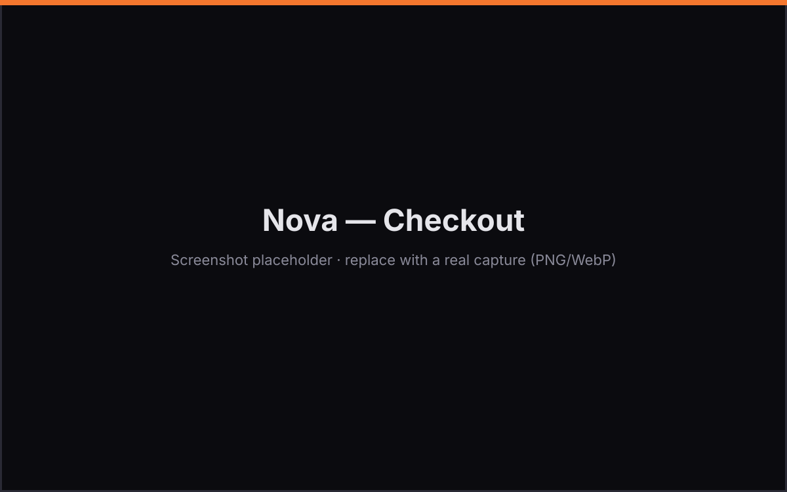
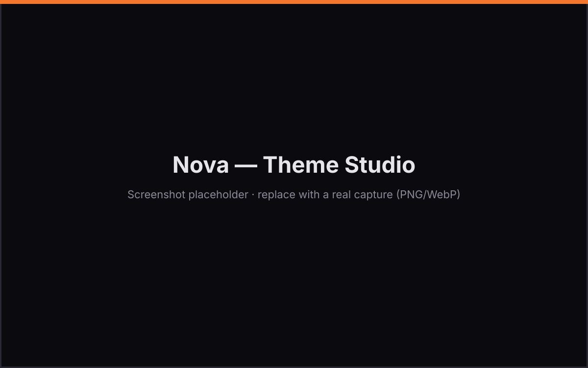

# Nova — Angular 21 eCommerce Template

A premium, production-ready eCommerce frontend for **Angular 21**, styled with
**TailwindCSS v4** and **Spartan-style UI** primitives. Fully responsive, light/dark
themed, animated, and designed to plug into **any backend API**.

  

## ✨ Features

- **7 routes**: Home, Catalog (filters/sort/sidebar), Product detail, Cart, Checkout, Wishlist, Order confirmation
- **Advanced catalog**: left-sidebar filters (category, price, brand, rating, in-stock, on-sale), sorting, grid/list view, pagination, mobile filter drawer, live facets
- **Light / dark / system theme** with persisted preference and smooth transitions
- **Cart & wishlist** backed by signals + `localStorage` (survives reloads), coupons, free-shipping progress, tax/shipping calc
- **Zoneless** change detection using Angular signals throughout
- **Spartan-style helm components** (`hlmBtn`, `hlmCard`, `hlmBadge`, `hlmInput`, …) driven by `class-variance-authority`
- **CSS animations** via Tailwind utilities (`animate-fade-up`, `animate-scale-in`, `animate-float`, shimmer skeletons, hover motion)
- **Lucide icons** through `@ng-icons`
- **Swappable data layer** — point it at any REST/GraphQL API and map any schema without touching components

## 🚀 Getting started

```bash
npm install
npm start          # dev server at http://localhost:4200
npm run build      # production build into dist/
npm test           # run the unit test suite (Vitest)
```

## 📸 Screenshots

> Placeholders — replace the files in `docs/screenshots/` with real captures
> (see `docs/screenshots/README.md`).

| Storefront | Checkout | Theme Studio |
|------------|----------|--------------|
|  |  |  |

## 🧩 Architecture

```
src/app/
├── core/                    # singleton services + swappable write providers
│   └── providers/           # 👈 the swappable write layer (auth, orders, cart, payments)
│       ├── models.ts             # normalized write models (AuthUser, Order, DraftOrder…)
│       ├── auth.provider.ts      # AuthProvider + AUTH_PROVIDER token
│       ├── commerce.provider.ts  # CommerceProvider + COMMERCE_PROVIDER token
│       ├── cart.provider.ts      # CartProvider + CART_PROVIDER token
│       ├── payment.provider.ts   # PaymentProvider + PAYMENT_PROVIDER token
│       ├── app-config.ts         # AppConfig + APP_CONFIG token (base URL, keys)
│       └── mock/                 # bundled mock defaults
├── layout/                  # header + footer shell
├── features/                # one folder per route (home, catalog, product, cart, …)
└── shared/
    ├── ui/                  # Spartan-style helm components (button, card, badge, input, rating, …)
    ├── components/          # composed widgets (product-card, skeletons)
    ├── utils/               # cn() class merger
    └── data/                # 👈 the swappable read layer (catalogue)
        ├── models.ts        # normalized domain models the whole UI consumes
        ├── data-source.ts   # EcommerceDataSource interface + DATA_SOURCE token
        ├── dummyjson-data-source.ts # default: real products from dummyjson.com
        ├── mock-data-source.ts   # offline demo data (bundled)
        ├── http-data-source.ts   # ready-made generic REST implementation
        ├── schema-mapping.ts     # map ANY API payload → models
        └── mock/            # bundled demo products & categories
```

The UI **only** talks to the normalized models in `models.ts`. Every backend is
translated into those models by an `EcommerceDataSource` implementation, so screens
never change when your API does.

> **Live demo data:** out of the box the template is wired to the free
> [DummyJSON](https://dummyjson.com) API (`dummyjson-data-source.ts`), so you see
> **real products with real imagery** immediately. Swap the `DATA_SOURCE` provider in
> `src/app/app.config.ts` for `MockDataSource` (offline) or your own backend at any time.

## 🔌 Connecting your backend

### Option A — use the built-in REST data source

Edit `src/app/app.config.ts`:

```ts
import { DATA_SOURCE } from './shared/data/data-source';
import { HttpDataSource, HTTP_DATA_SOURCE_CONFIG } from './shared/data/http-data-source';

providers: [
  {
    provide: HTTP_DATA_SOURCE_CONFIG,
    useValue: {
      baseUrl: 'https://dummyjson.com',
      endpoints: {
        products: 'products',
        product: (id) => `products/${id}`,
        categories: 'products/categories',
      },
      queryParams: { search: 'q', pageSize: 'limit', /* … */ },
      // 👇 Map ANY schema to the normalized model
      productMapping: {
        listRoot: 'products',      // array lives under res.products
        totalCount: 'total',
        id: 'id',
        title: 'title',
        price: 'price',
        thumbnail: 'thumbnail',
        images: 'images',
        categoryId: 'category',
        ratingAverage: 'rating',
        stock: 'stock',
      },
    },
  },
  { provide: DATA_SOURCE, useClass: HttpDataSource },
]
```

### Mapping any schema

Each field in a mapping accepts:

| Form | Example | Meaning |
|------|---------|---------|
| dot/bracket path | `'data.title'`, `'images[0].src'` | read a nested value |
| array of paths | `['title', 'name']` | first match wins |
| function | `(raw) => raw.attributes.title` | full custom logic |

Sensible fallbacks are built in (`id/_id/sku`, `title/name`, `images/gallery/photos`,
`rating.rate`, …), so many APIs work with little or no mapping. See
`src/app/shared/data/schema-mapping.ts`.

### Option B — write your own

Implement the `EcommerceDataSource` interface (GraphQL, tRPC, Firebase, etc.) and
provide it for `DATA_SOURCE`. That single change swaps the whole app's data source.

### The write path — auth, orders, cart & payments

The same pattern powers everything that **writes**. Each concern is an interface + a
DI token with a bundled mock default, swappable in one line in `src/app/app.config.ts`:

| Concern | Interface | Token | Default |
|---------|-----------|-------|---------|
| Auth | `AuthProvider` | `AUTH_PROVIDER` | `MockAuthProvider` |
| Orders | `CommerceProvider` | `COMMERCE_PROVIDER` | `MockCommerceProvider` |
| Cart | `CartProvider` | `CART_PROVIDER` | `LocalCartProvider` |
| Payments | `PaymentProvider` | `PAYMENT_PROVIDER` | `MockPaymentProvider` |

```ts
providers: [
  { provide: AUTH_PROVIDER, useClass: MyAuthProvider },
  { provide: COMMERCE_PROVIDER, useClass: MyCommerceProvider },
  { provide: PAYMENT_PROVIDER, useClass: MyStripeProvider },
]
```

Base URLs and keys live in one place — the `APP_CONFIG` token. See
**INSTRUCTIONS.md §3, §7 and §8** for full, copy-paste adapter examples (Platzi auth,
REST orders, Stripe payments) plus the auth HTTP interceptor.

## 🎨 Theming

Design tokens are CSS variables in `src/styles.css` (`:root` and `.dark`), mapped to
Tailwind utilities via `@theme inline`. Change the palette, radius, or fonts there and
the entire template follows. Custom keyframes/animations are defined in the same file.

## 🛠️ Tech

Angular 21 (standalone, zoneless, signals) · TailwindCSS v4 · Spartan `@spartan-ng/brain`
· `@ng-icons/lucide` · `class-variance-authority` · `clsx` · `tailwind-merge` · Vitest

---

Demo data is illustrative. Product imagery is served from `picsum.photos`.
